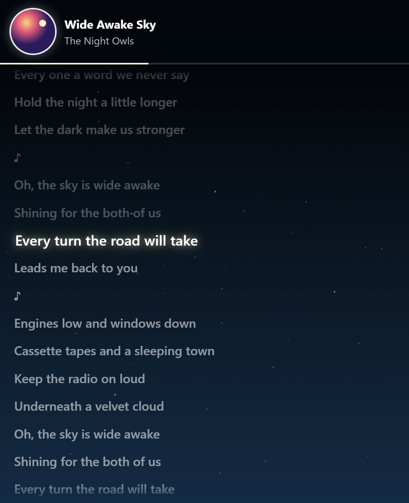
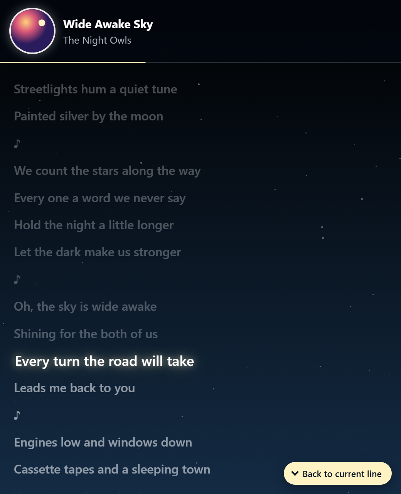
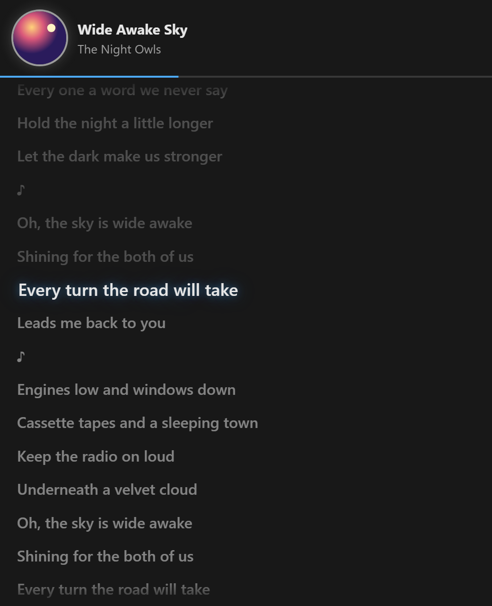
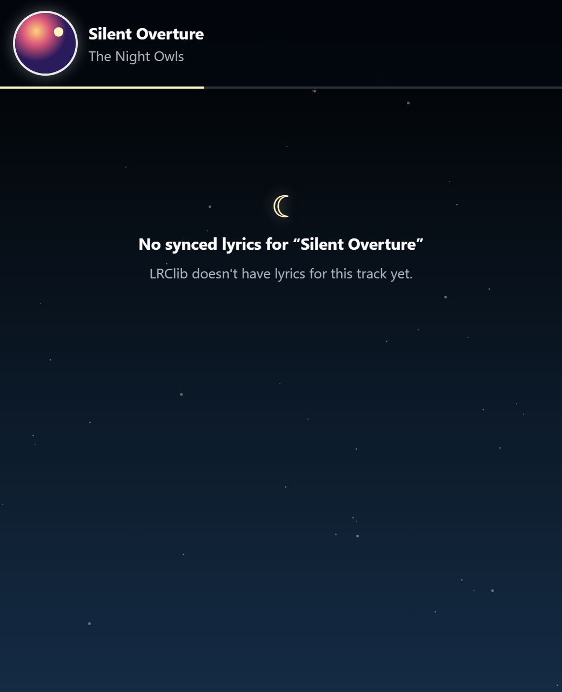
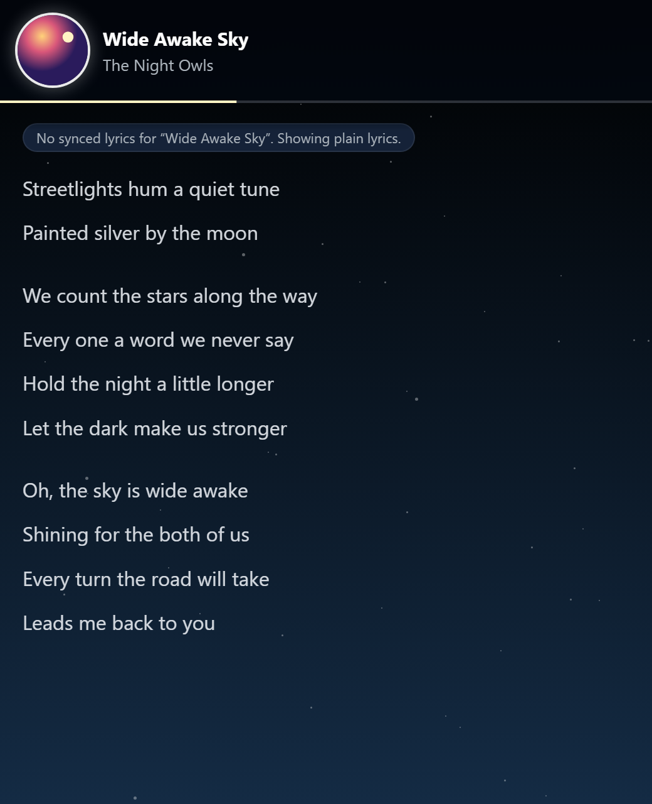
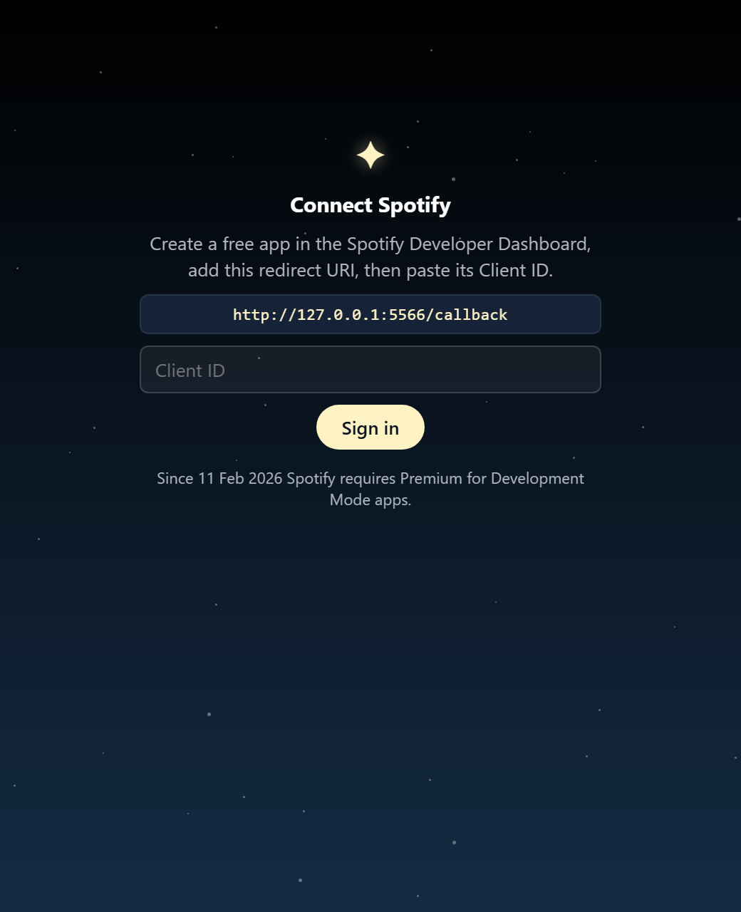

# Starlit Lyrics

Synced Spotify lyrics in VS Code, with a Starry Night theme. A from-scratch rebuild of
[Shuri](https://marketplace.visualstudio.com/items?itemName=o-p.shuri) that fixes stale lyrics,
the floating sync button and the plain styling.

<p>
  
  
  
</p>

## Features

- **Synced lyrics from LRClib**: exact lookup on title, artist, album and duration, with a fuzzy-search
  fallback. Results are cached per track.
- **Never stale.** On a track change the view clears instantly, and late results for an old track are
  thrown away.
- **Clear states** for signed out, nothing playing, paused, ad, podcast, loading, no lyrics,
  instrumental and plain (unsynced) lyrics.
- **Smooth timing.** Spotify is polled every 3 s while playing (and right when a song should end). Position is
  interpolated locally with `requestAnimationFrame`, so the active line stays within ~200 ms.
- **Follow mode.** The active line glides to about 40% from the top. Scroll away and a
  *Back to current line* pill appears at the bottom-right.
- **Click a line to seek** (needs Spotify Premium).
- **Word-level highlight** when LRClib has enhanced `<mm:ss.xx>` timestamps.
- **Two themes.** *Starry Night* (StarryNight Spicetify colors, twinkling stars and the odd shooting
  star) or *Match VS Code* (your editor theme's colors only). `prefers-reduced-motion` is respected.

<p>
  
  
  
</p>

## Setup

1. **Install** the `.vsix`: Extensions view → `…` → *Install from VSIX…*, or run
   `code --install-extension starlit-lyrics-0.1.0.vsix`.
2. **Create a Spotify app** at [developer.spotify.com/dashboard](https://developer.spotify.com/dashboard):
   - Redirect URI: `http://127.0.0.1:5566/callback` (or your `starlit.port`).
   - API: *Web API*.
   - Under *User Management*, add the email of the Spotify account you listen with.
   - You can reuse the app you made for Shuri if it already has this redirect URI.
3. Open the **Explorer** sidebar, expand **Lyrics**, paste the app's **Client ID** and click *Sign in*.
   Approve in the browser.
4. Play something in Spotify. To get lyrics in an editor column instead, run
   **Starlit Lyrics: Open Lyrics in Editor**.

> Since 11 Feb 2026, Spotify's Development Mode needs the app owner to have **Spotify Premium**.
> Without it, Spotify refuses the requests and the view says so. See INSPECTION.md for an evaluated
> fallback that reads the Windows media session instead.

## Settings

| Setting | Default | What it does |
| --- | --- | --- |
| `starlit.theme` | `starryNight` | `starryNight` or `matchVsCode` |
| `starlit.lyricOffsetMs` | `0` | Positive shows lines earlier, negative later (±5000) |
| `starlit.fontSize` | `16` | Lyrics font size in px |
| `starlit.followCurrentLine` | `true` | Auto-scroll to the active line |
| `starlit.port` | `5566` | Port for the sign-in callback |

Commands (prefix *Starlit Lyrics:*): Open Lyrics in Editor, Sign in to Spotify, Sign out of Spotify,
Show Lyrics 100 ms Earlier / Later, Toggle Follow Current Line, Switch Theme.

## Development

```sh
npm install
npm run check          # typecheck + unit tests (node --test, no extra deps)
npm run build          # bundle to dist/ with esbuild
npx @vscode/vsce package --no-rewrite-relative-links --allow-missing-repository
```

Press F5 in VS Code with this folder open to start an Extension Development Host.

- `src/core/` holds pure logic with unit tests: LRC parser, LRClib client, the track-change session
  with its stale-fetch guard, and the Spotify response mapper.
- `src/spotify/` has PKCE sign-in and API calls. `src/host/` has polling and webview wiring.
- `media/` is the webview (plain JS and CSS, no build step).
- `preview/index.html` renders the real webview in a browser with fake data, and
  `bash preview/shoot.sh` regenerates the screenshots with headless Chrome.

## Credits

Built after studying [Shuri](https://github.com/elbaph/shuri) by o-p (Unlicense). Lyrics come from
[LRClib](https://lrclib.net), and playback comes from the
[Spotify Web API](https://developer.spotify.com/documentation/web-api). The Starry Night palette
comes from the StarryNight theme for [Spicetify](https://spicetify.app).

## License

Unlicense (public domain), same as Shuri.
